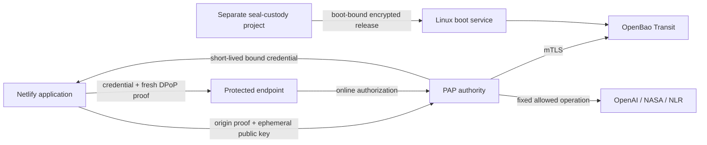

# Portable Access Profile

PAP is an open specification and Apache-2.0 reference implementation for short-lived, proof-bound application access. Applications prove their configured workload identity and receive credentials automatically. Provider keys stay in a separately operated broker, outside application source and environment variables.

Version 0.3.0 includes a Linux authority, OpenBao custody, a Netlify origin identity adapter, independent Instabox cold-boot seal custody, operator tooling, and three deployable examples. This is a production-oriented reference for controlled pilots. It has not had an independent security audit and does not provide high availability.

## What it secures

A signed credential binds an ephemeral application key to one subject, tenant, environment, audience and grant. Each request includes a fresh DPoP proof. The authority checks current policy and revocation online before returning data. The Netlify adapter renews its short-lived credentials and proof keys automatically. OpenBao stores issuer signing keys; provider credentials are encrypted using a distinct derived Transit key.

The first profile supports exact GET resources. It does not make arbitrary third-party APIs accept PAP. A fixed-operation broker adds support for existing API-key providers. Provider-root rotation requires an issuance/revocation API from that provider; operators still control replacement when that API does not exist.



## Try the local protocol

Requires Python 3.12 or later. The accelerated local demo exercises issuance, renewal, issuer-key replacement, replay rejection and revocation without an upstream API key. Its processes share a local UID. Use the isolated Linux profile for real deployments.

```sh
python3 -m venv .venv
. .venv/bin/activate
python -m pip install --require-hashes -r requirements.lock
python -m pip install --no-deps .
pap demo
pap conformance
```

## Deploy independently

1. Operate a dedicated maintained Linux host with authenticated time, persistent storage and a public HTTPS authority origin. Install pinned OpenBao and Caddy distributions separately. Follow [Linux deployment](deploy/linux/README.md), or the [Instabox adaptation](deploy/instabox/README.md).
2. Create an operator custody key using [pap-operator](docs/operator-cli.md), export its public key and pin, then initialize the fresh KMS with [the one-shot bootstrap](docs/operator-recovery.md). Keep encrypted recovery material off-host.
3. For the supported Instabox boot identity adapter, configure [automatic cold-boot recovery](docs/cold-boot-profile.md) with a separately administered seal-custody project. Its trust must remain independent of application deployments.
4. Register a dedicated production Netlify site and exact grant. Follow [project onboarding](docs/project-onboarding.md). Public defaults are disabled and contain no deployment credentials.
5. Enable one of the [three standalone examples](docs/use-cases.md). Configure [provider custody](docs/connectors.md) and import the provider key through the private operator channel. Run the genuine platform-event acceptance check.

No hosted PAP account, proprietary service, paid license, AWS account, or private repository is required. Netlify is the first implemented hosting identity adapter; the specification and Linux authority can support additional adapters. Operating this deployment still requires Linux and hosting-provider access.

## Repository map

| Path | Purpose |
| --- | --- |
| `docs/specification.md` | Open protocol and conformance requirements |
| `pap/` | Reference authority, validation, enrollment, boot and connectors |
| `pap/operator/` | Operator custody and RAM-only recovery/import tooling |
| `adapters/netlify/` | Application identity SDK and proof endpoint |
| `adapters/netlify-seal/` | Separate boot seal custody application |
| `examples/` | Independent space, charging and science projects |
| `deploy/` | Dedicated Linux/Instabox installation and acceptance tooling |
| `tools/` | KMS bootstrap, reviewed migration and dependency locking |
| `.github/workflows/` | Tests and reproducible release artifacts |

## Security and operating limits

Read [SECURITY.md](SECURITY.md), [the threat model](docs/threat-model.md), [the production profile](docs/production-profile.md), and [connector limits](docs/connectors.md). Netlify origin verification trusts the whole enrolled production site, not a hardware-attested function or commit. Host root, the hosting provider, custody administrators and OpenBao administrators remain trusted. Software KMS custody is not HSM protection.

Loss of the external seal key can make encrypted KMS data unrecoverable. A successful restart is not a full backup-restore test. Before customer production use, demonstrate isolated restore, configure audit retention and alerts, define availability and capacity targets, and complete independent review. Online policy and unavailable state fail closed.

## Develop and contribute

See [development](docs/development.md), [contributing](CONTRIBUTING.md), [governance](GOVERNANCE.md), and [the changelog](CHANGELOG.md). Changes to protocol validation, identity admission, custody, retries or revocation need corresponding negative tests. Contributions use the Developer Certificate of Origin.

## License

Copyright 2026 Aisen Lopez Ramos and contributors. Source, specification, operator tooling and examples are licensed under [Apache-2.0](LICENSE). Retain [NOTICE](NOTICE) and [third-party notices](THIRD_PARTY_NOTICES.md) when distributing. Provider names are trademarks of their owners.
