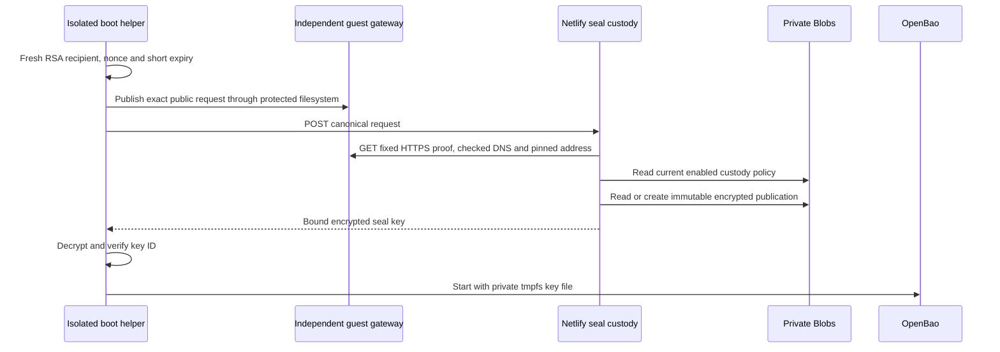

# PAP seal custody on Netlify

This service holds one OpenBao static-seal key outside the authority VM. A boot helper proves control of the registered provider HTTPS origin, then receives the key encrypted to a fresh RSA-4096 recipient. The helper places the recovered key in private tmpfs for OpenBao. It adds no application environment secret, permanent guest seal-key file, public key-setting endpoint or cloud management credential to the VM.

Deploy this directory to a dedicated trusted Netlify project. Do not use the application adapter's project. Every person, function, build plugin and deployment with this project's Blobs access belongs to the seal-custody trust boundary. Netlify encrypts Blobs at rest and in transit; Blobs is software custody under the provider's control, not an HSM. Origin verification proves control of the provider route. It does not attest guest hardware, kernel or source revision.

## Files and checks

```text
netlify/functions/pap-seal-release.mts   POST /v1/boot/release
netlify/functions/pap-seal-health.mts    GET /health
src/config.public.json                 public registration, disabled by default
src/protocol.mts                       strict wire schemas and canonicalization
src/transport.mts                      checked DNS and pinned HTTPS callback
src/store.mts                          private Blobs custody and immutable publications
src/handler.mts                        proof, current policy, encryption and idempotency
```

Use Node 24 and the committed lockfile. Its dependency versions match the application adapter's locked versions. `npm ci --ignore-scripts --cache /private/tmp/pap-seal-npm-cache` installs dependencies. `npm run check` typechecks, tests and builds both functions. The build makes no provider changes. Functions live outside `public/`; no source or custody record belongs in the static publish directory. No dependency install or build script provisions a secret.

Only a published production deployment with the configured site UUID and canonical custody origin can release keys. Preview and branch build commands fail. These checks prevent accidental use of the wrong deploy context; they cannot protect the store against malicious code authorized to deploy to this trusted project. Do not connect untrusted pull requests or add third-party build plugins to it.

## Public registration

`src/config.public.json` contains exactly these fields:

| Field | Binding |
| --- | --- |
| `v` | `1` |
| `enabled` | Must be `true` after deliberate provisioning |
| `custody_site_isolated` | Must be `true` |
| `site_id` | Dedicated custody Netlify site UUID |
| `custody_origin` | Canonical `https://NAME.netlify.app` origin |
| `deployment_id` | `example-deployment` |
| `machine_id` | `example-machine` |
| `origin` | `https://authority.example.com` |
| `key_id` | Lowercase hexadecimal SHA-256 of the raw 32-byte seal key |

The public registration contains no key material. The initial file is disabled and has a placeholder custody site UUID. Enabling it is a deployment operation, separate from the local implementation tests.

## Private provisioning and revocation

The private site-wide store is `pap-seal-custody-v1`. Its only lookup is the fixed key `deployments/example-deployment/current`. Provision one canonical JSON record with exactly `v`, `enabled`, `deployment_id`, `machine_id`, `origin`, `key_id` and `key_b64url`. `v` is `1`; `enabled` is a boolean; the deployment, machine, origin and key ID must equal the public registration. `key_b64url` is the unpadded base64url encoding of the raw 32-byte seal key. Runtime checks require its SHA-256 to equal `key_id`.

Use the supported `pap-operator custody-provision` workflow described in [the operator CLI guide](../../docs/operator-cli.md). It validates and decrypts the independently encrypted successor backup in memory before invoking `tools/provision.mjs`. The helper takes `--config PUBLIC_CONFIG_PATH --token-fd INHERITED_FD`, reads the canonical private custody record only from stdin, and reads Netlify authorization only from a separate inherited descriptor numbered 3 or higher. It accepts no provider authorization or private record in command arguments or environment variables. Its provider client uses the configured site UUID explicitly, a fixed store name and a fixed deployment key. It uses a create-only write, permits an exact existing record as an idempotent result, refuses a conflicting existing record, and validates a strongly consistent readback before returning a nonsecret receipt. The helper and operator have a 30-second provider deadline.

`--revoke` reads the existing record, validates every binding and key hash, and changes only `enabled` to `false` using the observed ETag as a conditional update. A concurrent change fails closed without a retry. An exact already-disabled record returns an unchanged receipt. Revocation cannot silently replace a key or re-enable an old record. Test this path with an isolated custody project before depending on it for incident response.

The operator must durably encrypt an independent backup before seal migration. Never paste the record into a terminal command, environment variable, repository, function log, conversation or public file. This service deliberately exposes no HTTP provisioning or administrative endpoint. It uses only Netlify's automatically supplied Blobs credentials at runtime, with no token/site override.

Every release attempt reads the current strongly consistent custody record. There is no policy or plaintext-key cache. Set the private record's `enabled` to `false` to deny new releases, including idempotent retries. Deletion, corruption or a missing key fails closed with HTTP 503. Disabling release does not reseal an already running OpenBao process or withdraw a key already delivered to trusted guest memory. Administrative sealing and incident response remain explicit operations.

An auto-sealed cluster depends on this seal key. Its operator recovery shares alone cannot decrypt storage if the external key is lost. Preserve independently encrypted seal-key generations and consistent Raft/PAP backups. Do not retire a previous generation until a tested migration and restoration procedure proves the new one. This adapter implements release for one pinned key generation; it does not advertise autonomous seal-key migration or root-key rollover.

## Boot protocol

The helper generates a fresh RSA-4096 key pair in memory with exponent 65537 and a 32-byte random nonce. It publishes a record at the exact registered origin path `/.well-known/pap/boot-proof/{request_id}`. The gateway must serve a file written only by root or the dedicated recovery UID, with no upload or request-reflection route. It must start independently of OpenBao and authority readiness. The public record grants no decryption ability without the recipient private key.

The POST body and callback body must be identical canonical UTF-8 JSON, with recursively sorted object keys, ASCII field values, no whitespace or trailing newline, and exactly:

| Field | Requirement |
| --- | --- |
| `v` | Integer `1` |
| `request_id` | Lowercase UUID generated for this request |
| `deployment_id`, `machine_id`, `key_id` | Exact configured values |
| `boot_id` | Lowercase UUID for this guest boot |
| `nonce` | Unpadded base64url of 32 random bytes |
| `iat`, `exp` | Integer Unix seconds; lifetime 1 to 120 seconds; unexpired, with at most 5 seconds issue-time skew |
| `recipient_jwk` | Exactly `kty: "RSA"`, `e: "AQAB"`, and `n`, a 512-byte unsigned modulus encoded as unpadded base64url |

Unknown/duplicate members, private JWK fields, extra routing arguments, bearer headers, cookies and compressed bodies are rejected. Requests and stored/callback JSON have a 4096-byte bound, bounded nesting, and strict UTF-8 decoding. The handler rejects an old issue time and rechecks expiry after the callback and before publication/return.

The custody service resolves the configured callback hostname, rejects every response set containing a nonpublic/reserved address, then pins an approved address directly into the TLS connection. It retains the original hostname for SNI and normal certificate verification. It follows no redirects, sends no caller-selected URL/header, accepts only HTTP 200 JSON, rejects content encodings, and bounds headers/body through EOF. One 12-second deadline includes body reading, DNS, callback and all store operations. Aborting the caller aborts that work.

After the proof and current private policy pass, the service wraps the raw 32 bytes using RSA-OAEP with SHA-256/MGF1-SHA-256 and label `SHA256(canonical_request_bytes)`. The response has exactly `v: 1`, `request_id`, `key_id`, and `wrapped_key`, the unpadded base64url 512-byte RSA ciphertext. The helper verifies the response bindings and recovered-key hash before exposing the key to OpenBao. Buffer wiping is best effort; the Node runtime does not promise zeroization of all managed strings or intermediate allocations.



## Retry, replay and abuse behavior

The separate private store `pap-seal-publications-v1` keeps immutable entries at `releases/{deployment_id}/{request_id}`. Each entry contains exactly `v`, the canonical request's `request_sha256`, `expires_at`, and the encrypted response. A create-only write chooses one publication under concurrency. A request with a different canonical digest under the same ID receives HTTP 409.

An exact retry revalidates the public proof, expiry and current policy, then returns the identical stored ciphertext. It neither encrypts again for an existing publication nor changes the recipient. This prevents a public observer from consuming a request before its legitimate owner. The helper may retry an uncertain response within the same proof's lifetime. A fresh request ID, nonce and recipient are required after expiry. Policy denial is terminal. Publications are not plaintext keys and are never served after proof expiry. They are retained until an authenticated operator applies a retention policy; arbitrary callers cannot create one without a valid current origin publication.

The function asks Netlify to limit the custody domain to 120 requests per 60 seconds and admits at most four in-flight requests per function instance, with no queue. Domain-level enforcement needs live provider validation; the process limit does not claim to be a global distributed quota. All responses disable browser and Netlify CDN caching. Functions set their own response headers; static `_headers` rules do not apply to function responses. No CORS policy is exposed.

Structured release logs contain only the fixed event name, outcome and HTTP status. They omit request contents, URLs, IDs, nonces, keys, proof records, ciphertext, provider errors and headers. HTTP 503 is temporary unavailability; 401 means expired proof; 403 means a policy/proof/deployment denial; 409 means request-ID conflict. A logging failure does not alter a release decision.

`GET /health` reports only `{"ok":true}` and does not inspect, initialize or reveal custody. The static status reports the service name and `production_accepted: false`. Neither endpoint is KMS readiness or recovery acceptance evidence.

## Provider references

- [OpenBao static seal](https://openbao.org/docs/configuration/seal/static/)
- [OpenBao migration and recovery-key limits](https://openbao.org/docs/concepts/seal/)
- [Netlify Blobs access and deploy scope](https://docs.netlify.com/build/data-and-storage/netlify-blobs/)
- [Netlify Functions API and configuration](https://docs.netlify.com/build/functions/api/)
