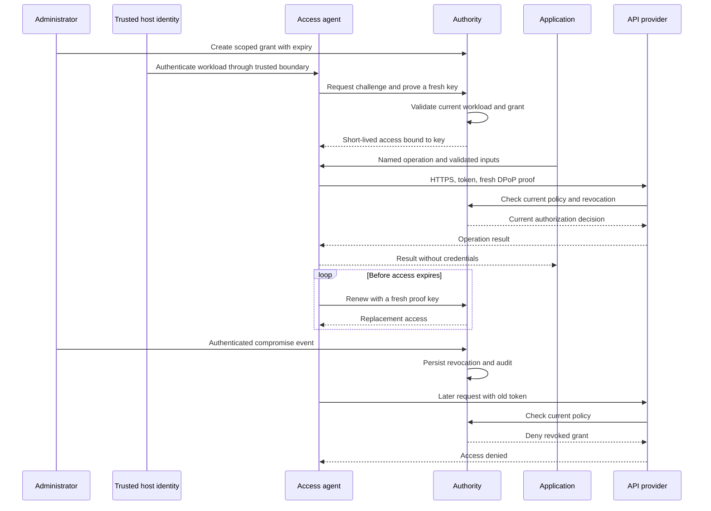

# Adopting Portable Access Profile

PAP 0.3.0 includes the runnable local profile, an OpenBao-backed Linux authority, an independent certificate-enrollment broker, a Netlify Functions adapter, an independent static-seal boot profile and fixed OpenAI/NASA/NLR compatibility operations. The network wire profile remains `PAP-Netlify-Origin-0.2`. Start with the [deployment contract](production-profile.md), [Netlify integration](../adapters/netlify/README.md), [Linux installation](../deploy/linux/README.md) and, when applicable, [Instabox host guide](../deploy/instabox/README.md). The [cold-boot profile](cold-boot-profile.md) adds a separate trusted Netlify custody service. Each independent deployment must establish its own lifecycle and recovery acceptance. AWS and Railway workload-identity adapters are not implemented.

An administrator permits a workload to perform named operations. The local application calls its agent; a Netlify server function calls the server-only SDK. Infrastructure manages credential lifetimes and reports whether access is healthy, denied, expired, or revoked. The Netlify SDK establishes registered site-origin control, not provider-issued workload attestation or deployment/commit identity. Functions sharing a trusted site also share its Blobs trust boundary; untrusted previews need a separate site.

## What each participant implements

| Participant | Required work | Why it exists |
| --- | --- | --- |
| Hosting platform | Supply independently verified workload identity; isolate agent state; provision trusted issuer configuration | Prevent one application from claiming another application's identity |
| API provider | Accept bound access, verify proofs, enforce operation grants, consult current policy, and define revocation behavior | A valid credential must grant only the permitted action |
| Agent operator | Run the isolated agent, renew access, manage proof keys, expose typed operations, report lifecycle failure | Keep cryptographic credential handling outside application code |
| Authority operator | Manage grants and signing keys, publish verification state, process revocation, retain audit evidence | Provide consistent permission and lifecycle decisions |
| Infrastructure/recovery operator | Isolate service UIDs, protect enrollment/operator roots, operate independent seal custody, retain encrypted off-host recovery and test restoration | Recover infrastructure without giving applications issuer or administrative credentials |
| Application developer | Call named operations, handle permission errors, supply idempotency keys for writes | Keep application integration small and make retries safe |

One organization may operate several roles. Their permissions should remain separate. In particular, an application should not inherit administrative authority merely because it can use an operation socket.

## Integration flow



The diagram shows the local agent contract. In the Netlify profile, the SDK generates an ephemeral proof key, publishes an authenticated public challenge record through the site's Blobs/proof endpoint, and the authority verifies that exact record at the registered HTTPS origin before issuance. The resource function consults current authority policy on every protected GET. See the [network flow](production-profile.md#2-enrollment-and-request-flow) for its separate identity and storage boundaries.

## Run and inspect the local reference

Use the repository README for the exact installation, test, demo, and CLI commands. Run the demo in a fresh private state directory. It creates its own local keys and certificate material. It does not need an existing cloud account, API credential, or production data.

The `pap note` command requires `--idempotency-key`. From the repository directory, with the local service already running, an example is:

```sh
.venv/bin/python -m pap note --state /tmp/pap-local --idempotency-key 5caf57b8-c1d7-49c0-8759-76013ad48af6 "An example note"
```

Reuse that UUID when retrying the same write, including after an uncertain response. Use a new UUID for a different intended operation. The CLI requires an explicit value so a retry cannot silently generate a different operation identity. The SDK likewise requires `idempotency_key` when calling `Client.create_note`. Retrying an incident signal should reuse its optional `--event-id` for the same reason.

The demo's network service binds to loopback and uses HTTPS. Authority, admin, and application-agent operations use separate Unix sockets. Non-secret configuration includes the runtime directory, configured identities, selected tenant and environment, operation grants, and lifecycle durations.

Inspect the demonstration and test reports for evidence of access renewal, proof-key replacement, signing-key transitions, TLS credential replacement, rejected replay, persistent revocation, and write idempotency. A specification requirement without a corresponding passing check remains an unverified requirement.

The service recovers an interrupted runtime-manifest temporary write during startup under the host lock. Private-state persistence preserves revocations and idempotency results across restarts. Creating a fresh state directory creates a different demonstration authority; it does not recover the previous identity or its policy history.

Do not deploy the single-UID demo unchanged as a security boundary between applications. A local process under the same UID can access the user's files and sockets. Before testing containment, separate the application, agent, authority, and administrative identities and restrict which sockets each can reach.

## Hosting-platform adapter contract

A host adapter must answer a precise question: which workload is making this request, and why should the authority trust that answer?

The adapter should deliver a signed, short-lived identity assertion or establish an authenticated channel. It must bind identity to deployment and environment, give it a specific audience, and prevent another tenant from obtaining the same identity. The issuer relationship must be provisioned through trusted administration.

Do not use public project names, runtime environment labels, a shared account key, source repository ownership alone, or a caller-provided hostname as identity proof. Replacing one shared environment secret with another shared bootstrap secret leaves the original distribution problem in place.

A platform integration also needs a way to run or provide the agent outside the application's trust boundary. A managed operation gateway is another option, provided it authenticates workloads and never returns provider secrets. A platform that cannot supply a trustworthy workload identity cannot claim native PAP support merely by installing an SDK.

The local adapter and certificate-enrollment broker authenticate native Unix peer UIDs. The Netlify adapter separately verifies control of an allowlisted HTTPS site using a fresh proof and a site-published public challenge. It does not satisfy the stronger provider-issued identity contract above. Cloud assertions, Kubernetes identity, SPIFFE identity and host attestation require separate verified adapters. An SDK alone does not create process isolation within a serverless function.

## API-provider adapter contract

The API provider should register a stable resource audience and typed operations. Each request must carry bound access and a fresh proof. The verifier must check request bindings and current grant state before running the operation.

The local reference makes one online authorization decision per protected request. A production provider that introduces an authorization cache must declare a maximum revocation delay and test it. It cannot claim the local profile's next-authorization revocation guarantee while accepting cached permissions after revocation.

Writes need idempotency semantics that cover the mutation and the stored result. Define the key format, authorization scope, conflict behavior, retention window, and quota accounting. Every automated retry must be consistent with those semantics.

Legacy APIs cannot gain native sender-constrained access through a client SDK alone. The optional [compatibility broker](connectors.md) stores their keys as OpenBao Transit ciphertext and executes fixed permitted operations for the three standalone examples. It supports central replacement and local revocation. Automatic provider-key issuance, replacement and upstream revocation require provider-supported management APIs; this release does not claim those capabilities. Provider keys do not enter application environment variables, source or responses.

## Credential operations and recovery

Operators should observe permission health without handling private credential values. Useful status fields include current grant state, expiry, last successful renewal, next renewal deadline, current issuer key identifier, rotation phase, TLS certificate expiry, revocation event identifier, and failure category. None of these require displaying a private key or token.

| Failure | Automated behavior | Required operator action when recovery fails |
| --- | --- | --- |
| Temporary authority interruption | Bounded renewal retries; no use of expired access | Restore authority availability; inspect failure records |
| Access expires without renewal | Agent and API deny further access | Repair identity or authority configuration |
| Planned issuer replacement | Publish readiness, switch issuance, drain old verification keys, retire them | Investigate failed reconciliation; do not copy keys into applications |
| Issuer/listener TLS replacement in the enrollment profile | Local UID-authenticated broker issues fresh leaves, even when old leaves have expired; OpenBao reloads listener material without restarting | Restore the independent enrollment broker, protected CA custody or fixed identity configuration |
| Memory-preserving pause | Broker repairs expired leaves; issuer obtains a fresh certificate-bound login; Netlify may wait within its bounded recovery budget | Inspect actual wake/readiness results; do not bypass TLS or reuse expired credentials |
| Cold boot with the new static-seal profile | Boot helper proves the registered HTTPS origin, retrieves the key encrypted to a fresh recipient, places it in private tmpfs and permits OpenBao startup; missing/denied custody fails closed | Investigate custody, time, routing or persistent incident lock. Collect changed-boot evidence for this installation before relying on unattended recovery |
| Historical Shamir deployment restart | OpenBao starts sealed; authorization fails closed | Use the historical operator-controlled unseal procedure; never apply it as a substitute for a missing static-seal key |
| Grant expires | Deny on each request; sweeper records expiry | Make an explicit new permission decision if access is still needed |
| Authenticated compromise event | Persist revocation; deny future authorizations | Investigate and recover workload before reauthorization |
| Authenticated issuer-key compromise event | Reject affected key immediately and activate a replacement | Investigate why the key leaked and invalidate affected access |
| Authority process or trust-root compromise | No complete automated trust-root recovery in this release | Contain trust, provision independent replacement, invalidate affected access |

The historical one-shot Shamir bootstrap encrypts initialization material before using its shares and revokes the initial root token after actual signing/permission probes. The separate operator CA is never available to the enrollment broker. The default bootstrap packet stores all five shares under one operator custody key. This is single-operator custody rather than a three-person quorum; a quorum requires separately designed distribution and recovery procedures. Static-seal migration additionally needs the independently encrypted successor packet containing the external seal key and its deployment binding. Recovery shares alone cannot decrypt static-sealed storage. The [operator recovery runbook](operator-recovery.md) distinguishes those profiles and the [cold-boot contract](cold-boot-profile.md) defines boot-time custody release and its persistent incident lock. Test live migration and actual changed-boot recovery for the intended deployment; neither a configuration file nor a local fixture establishes that result.

Automation reduces routine key work. It does not remove permission decisions or compromised-host investigation. The new boot recipient private key stays in process memory; the released seal key stays in private tmpfs/systemd credentials, with no environment secret or persistent plaintext guest key. This is software custody without TPM/HSM protection. Guest root, Instabox routing/provider control and the separate custody project's administrators and trusted code remain trusted. Seal-root and CA rollover, full restoration, remote alerts and audit-log retention/rotation still need operational owners.

## Maturity and deployment gates

| Level | What it means for PAP | Status of this version |
| --- | --- | --- |
| Runnable local profile | Reproducible local HTTPS operations, isolated interfaces, automated credential lifecycle, adversarial tests | Implemented; single-UID demonstration is not a production isolation boundary |
| Hardened deployed reference | External nonexportable signing, separate Linux service identities, independent enrollment, encrypted operator recovery and verified public HTTPS | Implementation supplied; establish and retain deployment-specific acceptance evidence |
| Production service | Verified platform identity, enforced process isolation, independently reviewed crypto handling, reliable persistence, monitored operations, tested recovery | Requires deployment-specific engineering and review |
| Enterprise deployment | Multi-organization policy, administrative RBAC, approvals, external audit retention, compliance evidence, key custody, disaster recovery | Not implemented |
| Large distributed deployment | Multi-region consistency contract, coordinated issuers, bounded revocation propagation, global quota strategy, capacity and fault testing | Not implemented |

For production adoption, verify the following in the intended environment. A passing reference implementation or a public deployment does not discharge these deployment-specific requirements:

1. Authenticate workload identity through a real host boundary. Test that a neighboring deployment and a different tenant cannot impersonate it.
2. Isolate application execution from agent private memory, authority sockets, state files, and admin privileges. Verify the boundary with a deliberately compromised application process.
3. Use managed cryptographic custody or an explicitly reviewed key-storage design. This reference uses nonexportable software OpenBao Transit keys and sealed storage, with operator-encrypted recovery material. It does not claim an HSM, protection from VM root/provider access, or completed storage-backup restoration. The local demo still stores private issuer keys in its private SQLite state.
4. Respect the single-instance transactional ownership model. Test crash points, state rollback, backup restoration and revocation survival. Horizontal scaling requires a separately designed shared replay/quota/policy consistency contract; copying SQLite state to multiple issuers is unsafe.
5. Add bounded load admission before expensive verification, deployment network controls, per-tenant resource limits, and capacity tests. A local rate limiter is not a DDoS service.
6. Export audit events to a separate access and retention boundary. Add alerts for renewal failure, expiry, excessive denial, replay, issuer lifecycle failure, policy-store failure, and time drift.
7. Review clock assumptions, graceful draining, TLS rollover, administrative recovery, and dependency updates. Run independent penetration and protocol reviews.
8. Publish measured latency and availability under the intended online-authorization model. Validate actual idle/pause wake and cold-start recovery against the chosen availability contract. Choose a provider plan whose actual activity and idle behavior fit the workload. A development plan does not establish HA, an availability SLO or a throughput guarantee. Record wake and cold-boot recovery under the chosen plan.

## Open specification process

Implementations should pin a profile version and publish their conformance results. Proposed changes should include the threat addressed, wire or policy changes, compatibility impact, failure behavior, and tests. New transports and identity adapters should be reviewed independently rather than accepted because they use a familiar token format.

The specification documents and code use Apache-2.0, as recorded in the repository LICENSE. Implementers do not need to use a hosted PAP service. See [governance](../GOVERNANCE.md), [contribution guidance](../CONTRIBUTING.md) and the [security policy](../SECURITY.md) for the release process and reporting boundaries. No certification or trademark permission is implied by implementing the profile.

Independent implementation is the next interoperability milestone. A second authority and verifier should process the same public test vectors and agree on denial behavior, grant scope, proof validation, renewal, and revocation semantics. Provider logos and universal compatibility claims should wait for that evidence.

## Primary references

- The [PAP-local-0.1 specification](specification.md), [PAP-Netlify-Origin-0.2 profile](production-profile.md), [cold-boot profile](cold-boot-profile.md), [threat model](threat-model.md) and [operator recovery runbook](operator-recovery.md) define this proposal's contracts and limitations.
- [RFC 9449](https://www.rfc-editor.org/rfc/rfc9449.html) defines DPoP mechanisms used by this reference.
- [RFC 8693](https://www.rfc-editor.org/rfc/rfc8693.html) and [RFC 8414](https://www.rfc-editor.org/rfc/rfc8414.html) are relevant to future OAuth network adapters. PAP-local does not claim to implement those profiles.
- [SPIFFE concepts](https://spiffe.io/docs/latest/spiffe-about/spiffe-concepts/) explain workload identity and trust domains.
- [WIMSE architecture draft](https://datatracker.ietf.org/doc/draft-ietf-wimse-arch/) is related standards work. Its status is an active Internet-Draft as checked on 2026-10-22.
