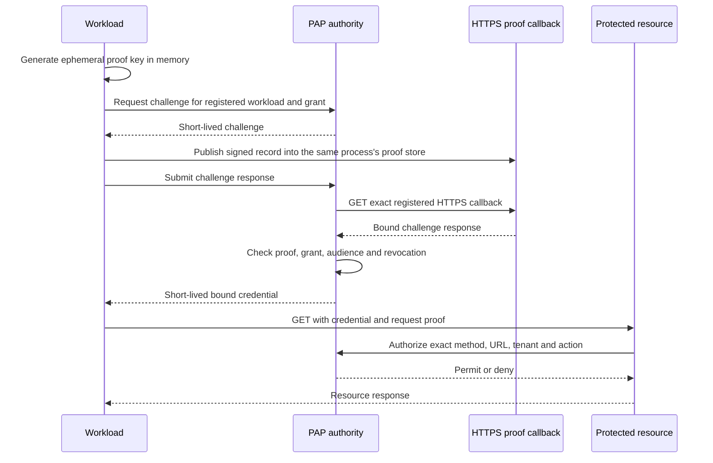

# Identity adapters

PAP separates the authority's access policy from the mechanism used to prove a workload's identity. An adapter supplies evidence for an already registered identity. It cannot create a grant, change a tenant, widen an audience, or turn an unregistered origin into a workload.

## Implemented adapters

| Adapter | Deployment | Evidence | Trust boundary |
| --- | --- | --- | --- |
| `netlify` | Dedicated production `SITE.netlify.app` origin | HTTPS callback containing the challenge response signed by an ephemeral workload key | Everyone allowed to deploy code or change routing at that Netlify site |
| `https-origin` | Docker, a VM, or a server with a canonical public HTTPS origin | The same HTTPS callback and ephemeral-key proof | Everyone allowed to control DNS, terminate TLS, change routing, or deploy code at that origin |

Both adapters use short-lived credentials and online authorization for prompt revocation. The authority validates a fixed registered origin, pins publicly routable DNS results for each callback connection, verifies TLS, refuses redirects, and limits the callback response. The workload verifies the authority over HTTPS. No shared bootstrap secret is required in the application.

HTTPS origin control is not provider-signed workload attestation. A provider OIDC token, SPIFFE certificate, or hardware-backed attestation requires another adapter with its own issuer, audience, subject, replay and freshness checks. Adding an adapter name without implementing those checks would weaken the identity boundary.

## Origin registration

Register each workload's exact public origin, UUID, subject, tenant, grant, environment, resource path and action through the private operator channel. Set `identity_adapter` explicitly for new registrations. Existing Netlify registrations retain their historical default. Do not change an existing grant's adapter or origin in place. Use a new subject and grant, validate it, then revoke the old one.

The workload UUID is an operator binding, not evidence of a provider account or project ID. Origin-control identity follows whoever controls the origin. Revoke its grant before retiring, transferring or releasing a domain or platform hostname; reassignment cannot be detected by the HTTPS proof alone. Use a finite grant expiry as an additional policy boundary.

`https-origin` accepts a canonical DNS hostname over HTTPS on port 443. It rejects credentials in URLs, IP literals, local names, path/query/fragment components, alternate ports, trailing dots and noncanonical hostnames. The authority rejects private, loopback, link-local, multicast and otherwise nonpublic callback addresses at connection time. Custom domains belong to this adapter even if Netlify or another platform hosts the application.

The registration example is in [the Docker example](../examples/docker-https/registration.example.json). Expiry is an absolute operator policy, not a renewable user API key. Renewal cannot extend a revoked or expired grant.

## Adapter protocol

The public callback only reads records that the workload published locally. An HTTP caller cannot publish a proof or ask the callback to sign an arbitrary challenge. Every resource request needs its own method/URL-bound proof. The authority consumes replay state during online authorization.

## Adding another platform

The reusable Python client and callback store live in `pap.workload`. A framework adapter needs to install the callback, call `authorize_request` before releasing its protected resource, and ensure that issuance and callback share a proof store. The [Docker deployment](docker-https.md) is the reference for a single-process server. The existing Node package implements the corresponding Netlify flow.

Do not trust arbitrary forwarding headers, caller-chosen resource URLs, or a caller-selected adapter name. The operator selects the identity adapter in the authority's registration. Keep provider verification code independent of tenant policy and connector credentials. A new platform may reuse `https-origin` when its trust boundary fits; a stronger provider identity requires a separately reviewed verifier.

## Scope

This release supports one registered GET resource per workload. It does not authorize writes, sign arbitrary request bodies, or automate root-key issuance at third-party APIs. PAP renews its own workload credentials automatically. Upstream credential rotation still depends on the provider's supported issuance and revocation APIs.
