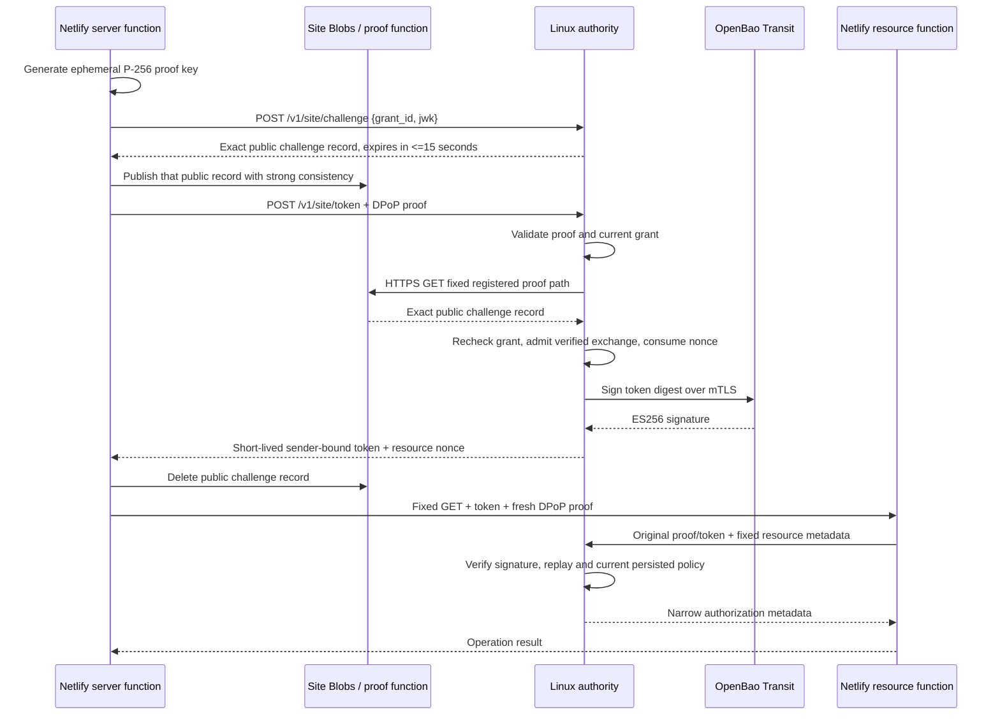

# PAP-Netlify-Origin-0.2

Status: proposed open profile and PAP 0.4.0 reference release. The network wire profile is unchanged. Document and original implementation license: Apache-2.0. This repository provides source, tests and deployment procedures; an installation must establish its own operational acceptance. This is a single-host reference suitable for evaluated pilots, not a ratified standard, provider endorsement, independently audited service or complete OAuth authorization server.

This document specifies the `netlify` identity adapter. Release 0.4 also implements `https-origin` for a registered public HTTPS server. It reuses these challenge, token and authorization routes with the separate origin validation and trust boundary defined in [identity adapters](identity-adapters.md). The operator's registered adapter selects the verifier; a caller cannot choose it in a public request.

The requirements words MUST, MUST NOT, SHOULD and MAY apply only to this profile. The existing [local specification](specification.md) continues to define `PAP-local-0.1`. This document adds network issuance from a registered Netlify origin and external key custody. It deliberately names the weaker identity property: **control of a configured site**, not cloud workload attestation.

## 1. Identity and containment

Each permitted site MUST be registered by a trusted operator with a canonical `https://SITE.netlify.app` origin, Netlify site UUID, workload subject, tenant, production environment, grant ID, absolute grant expiry, one GET resource path and one action. Origins containing deploy-preview `--` names, user information, ports, paths, query strings, controls or normalization ambiguities MUST be rejected. The first profile does not support custom resource domains or arbitrary request methods.

Registration MUST explicitly acknowledge that all code with access to the site's Blobs storage is trusted. Netlify Blobs are shared across that site's deploy contexts. A function's runtime context check is not a boundary against another deployment that can read/write the same site store. Untrusted previews MUST use a separate site. Site ownership and project membership in Netlify remain upstream trust roots.

The authority MUST persist the registration binding and refuse silent rebinding. Restarting MUST NOT restore expired or revoked access. Removing a site from active configuration MUST make its existing token unusable through the online authorization path. Extending an expired grant or restoring a revoked workload requires a separate reviewed administrative procedure; this reference release intentionally has no public enrollment, grant-edit or re-enable API.

The application MUST NOT receive the authority's issuer private key or an OpenBao credential. The Netlify SDK owns an ephemeral non-extractable P-256 proof key and a temporary access token in function memory. Its API returns operation results and has no credential getter. This prevents accidental credential distribution through the SDK API; it does not isolate a malicious module executing inside the same function. Such a module can invoke the site's allowed operations.

The Linux deployment MUST run the authority, OpenBao, administrator and application as different UIDs with dedicated groups. Authority state MUST be `0700` and its files `0600`; application UIDs MUST not be able to inspect it or connect to the administrative socket. The authority process MUST be non-root, have no effective/permitted/inheritable/ambient capabilities, no saved privileged UID/GID, no additional group privileges and no-new-privileges enabled. Service filesystem, namespace and process visibility restrictions are specified in the supplied systemd units.

## 2. Enrollment and request flow



The authority's public HTTPS origin MUST be operator configuration, never reconstructed from untrusted Host or forwarded headers. HTTP inside the guest is loopback-only between the trusted TLS proxy and authority. The external public URL must actually provide validated HTTPS. An Instabox gateway's TLS termination and guest-side exposure require the additional actual-host checks in [the Instabox guide](../deploy/instabox/README.md).

### POST `/v1/site/challenge`

Request: exactly `{ "grant_id": STRING, "jwk": PUBLIC_P256_JWK }`. JWK validation is the same strict public ES256 subset as the local profile; private members are forbidden.

Response: exactly these six public fields:

```json
{
  "challenge_id": "RANDOM_CANONICAL_UUID",
  "nonce": "VERSIONED_AUTHENTICATED_NONCE",
  "jkt": "RFC7638_THUMBPRINT",
  "issuer": "https://REGISTERED_AUTHORITY_ORIGIN",
  "site_id": "REGISTERED_NETLIFY_SITE_UUID",
  "expires_at": 2000000000
}
```

The example's uppercase strings and epoch are descriptive placeholders, not an installable registration. The record MUST expire in at most 15 seconds, capped by grant expiry. Initial challenge creation is stateless: it MUST NOT allocate a database challenge/nonce slot or spend a verified issuance quota. Knowledge of a public grant ID MUST NOT grant access or let an anonymous caller exhaust that grant's verified renewal budget.

The nonce is a canonical, unpadded base64url encoding of exactly 53 bytes, producing 71 characters:

| Field | Bytes | Encoding |
| --- | --- | --- |
| Version | 1 | `0x01` |
| Expiration | 4 | Unsigned Unix seconds, big-endian |
| Grant selector | 16 | First 16 bytes of SHA-256 of the UTF-8 grant ID |
| Authentication tag | 32 | HMAC-SHA-256 over the binding below |

The tag MUST bind this exact ordered array, serialized as ASCII JSON with `ensure_ascii=true`, separators `,` and `:`, and no whitespace: `["PAP-site-challenge-v1", issuer, site_id, site_origin, grant_id, jkt, challenge_id, expires_at]`. The selector is a lookup hint, not a credential; configurations containing a selector collision MUST be rejected. Noncanonical base64url, wrong version/size, unknown selectors, invalid tags, expiry and a nonce for another key or challenge ID MUST fail before the callback.

The reference authority generates a fresh 32-byte HMAC key in process memory at registry startup. Restart invalidates unfinished challenges from that process; callers obtain new challenges. It does not invalidate already issued access tokens or reset persisted grant/revocation/replay state. This is a single-process challenge design, not a key-sharing protocol for multiple authority instances.

The SDK publishes that exact public record in its site's strongly consistent Blobs store. `GET /.well-known/pap/site-proof/CHALLENGE_UUID` MUST be lookup-only and publish only a valid, unexpired record. It MUST NOT sign arbitrary input, accept writes, reflect a caller-supplied record, expose private keys/tokens or perform a caller-selected fetch. Deleting the record after exchange limits residual storage; record disclosure is not equivalent to private-key possession.

### POST `/v1/site/token`

Request: exactly `{ "challenge_id": UUID, "jwk": PUBLIC_P256_JWK }` with a DPoP header signed by that key for POST and the fixed configured issuer URL plus `/v1/site/token`. Its nonce MUST authenticate the reconstructed challenge record under the current in-memory HMAC key.

The authority MUST validate the proof before issuing an outbound callback lookup. It MUST fetch only its registered Netlify origin and fixed callback path. It MUST reject redirects, non-JSON/oversized/duplicate-member records and any field/value difference from the reconstructed authenticated challenge. DNS resolution MUST validate all returned addresses as public unicast and pass those checked addresses directly to the TLS connection. A separate preflight DNS lookup followed by a fresh unchecked resolution is insufficient. Response reading MUST enforce the size bound through EOF.

Only after the fetched origin record exactly matches the authenticated challenge may the authority persist the challenge and issuance nonce. It MUST then recheck current workload/grant policy and expiry, apply the durable verified exchange quota of 30 per minute per grant, and admit the issuance nonce. Token issuance separately applies the durable workload issuance quota of 30 per minute and consumes the nonce and proof ID atomically with issuance state. Revocation during the lookup MUST prevent issuance. A consumed, expired or wrong-key challenge MUST fail.

A crash after the issuance transaction commits may leave a challenge row without its consumed marker. If that persisted row exists and its issuance nonce is missing, retry MUST NOT recreate the nonce: the earlier issuance may already have succeeded. An uncertain response therefore MUST NOT cause a second successful exchange of that challenge. A fresh challenge and proof key permit recovery without reusing the uncertain exchange.

Response: exactly `access_token`, `token_type: "DPoP"`, `expires_at`, `expires_in`, `dpop_nonce`, `tenant` and `environment`, using the local profile's strict ES256 claims. Default production token lifetime is 60 seconds, bounded to 4–300 seconds by configuration and never beyond grant expiry. These responses MUST NOT be cached or logged.

### POST `/v1/authorize`

The resource middleware sends the original `Authorization: DPoP TOKEN` and `DPoP: PROOF` headers with exactly `{method, url, tenant, action, audience}`. The URL and action MUST come from the resource middleware's trusted configuration, not caller-supplied route metadata. The proof remains bound to the original resource GET URL, not the authorization endpoint.

The authority MUST bind the token's grant to its current registered site, exact resource path/action, tenant, environment and audience. It MUST validate token signature/lifetime, workload epoch, grant expiry/state, server nonce, proof target, access-token hash and durable replay admission for every request. This implementation has no positive authorization cache.

Successful response: exactly `{subject, tenant, environment, grant_id, action, expires_at}`. Neither an authorization response nor knowledge of a subject is a reusable bearer credential. Failure or unavailability MUST deny the resource request. The first profile is GET-only; a mutating profile needs resource-side commit-time revocation and idempotency semantics and MUST NOT be claimed from this middleware.

## 3. External key custody and automatic lifecycle

The production authority MUST use OpenBao Transit over authenticated TLS with a dedicated mTLS client role. It MUST have no environment bearer token, persistent token file or local issuer-key fallback. Certificate-auth login obtains a scoped temporary token kept only in memory. The signer reacquires it before expiry. OpenBao's internal infrastructure credentials and Netlify's platform-provided Blobs authentication still exist; the claim is absence of permanent **user-managed application** environment secrets.

Each issuer generation is a named OpenBao P-256 key with `exportable=false`, `allow_plaintext_backup=false` and pinned version 1. The authority stores only the public JWK and opaque provider reference. It MUST record a deterministic generation intent before a remote creation request. After an uncertain result or crash, retry MUST resume that same named generation, not create unbounded replacements. Activation requires a real sign-and-local-verify readiness check. An old key drains until the latest issued token expiration plus clock skew.

The signer sends the SHA-256 digest to Transit with explicit prehashed signing and JWS output. It MUST verify the returned 64-byte JOSE signature against the pinned public key. The deployed Transit mount is exclusive to PAP. Its issuer ACL matches complete path segments; it MUST NOT use a trailing key-name prefix glob that also grants child operations such as key rotation or configuration. The version-one signing parameter is the decimal JSON string `"1"`, accepted by Transit's integer field and matched exactly by the ACL. OpenBao's ACL equality does not coerce HTTP JSON numbers to HCL integers. A provider failure MUST never trigger local signing. The authority refuses a state database that contains local issuer private keys.

Production default issuer rotation is daily. Retired named keys remain in OpenBao; retirement removes authorization trust and blocks local signer reuse, not remote physical destruction. Operator capacity, encrypted backup and retention policy MUST account for retained generations. Deleting a private key alone cannot revoke already issued signatures. Online durable policy is the revocation mechanism.

The issuer's mTLS client certificate has a one-hour target lifetime and renews when less than five minutes remain. A new generation uses a fresh P-256 key. The manager validates the pinned issuing CA signature, exact common name, client-only EKU, non-CA status, key usage, key/certificate match and bounded validity. It fsyncs a private generation before atomically switching a `current` symlink. TLS loading resolves that pair once, preventing mixed certificate/key generations. The enrollment profile authenticates the issuer's kernel UID through a separate local broker, including when its prior certificate is missing or expired. The prior certificate grants no recovery authority. Replacing it discards the cached certificate-bound OpenBao token and requires a new authenticated login before readiness. The legacy profile without this broker continues to reject expired bootstrap credentials.

The enrollment broker separately renews OpenBao's listener certificate and key. OpenBao 2.7 automatically reloads the published generation without restarting its unsealed process. Its dependency on the broker starts the broker in order but MUST NOT propagate a broker restart into a KMS restart. The broker CA key arrives through systemd's private read-only runtime credential mount: root ownership, exact service-UID ACL and read-only mount flags are checked; a generally group-readable private file remains invalid. The broker may issue only its configured issuer identity and fixed loopback server identity. An independent operator CA is required for privileged KMS administration and is never available to the broker.

The historical one-time Shamir bootstrap durably encrypts the initialization response to a pinned operator public key before using its shares. It tests actual issuer signing and denied operations before revoking the initial root token. An uncertain initialization result MUST stop automatic retries. The recovery packet belongs off host under independent operator control. Manual Shamir unseal remains a historical-profile recovery procedure; it is not the new boot contract and cannot replace an external static-seal key after migration.

### Independent cold-boot seal profile

The [cold-boot profile](cold-boot-profile.md) uses OpenBao's built-in static seal and a separate trusted Netlify custody project. A root boot helper generates a fresh private RSA recipient in memory and publishes its exact short-lived request through the registered Instabox HTTPS origin. Custody verifies that origin proof and current release policy, then encrypts the seal key to that recipient. The helper MUST verify response/request bindings and the configured key hash before installing plaintext key bytes in private tmpfs for the systemd OpenBao credential mount. It MUST NOT store the seal key in environment variables, source, command arguments or persistent plaintext guest files. Encrypted off-host recovery material remains necessary.

The public proof gateway MUST start independently of the authority and KMS. Temporary clock/custody failures permit bounded backoff without a fixed short startup cutoff; authorization denial, response/pin failure and the persistent incident lock remain fail-closed. The helper prepares a boot credential and exits. It does not watch or undo an administrator's deliberate seal operation. Remote release revocation cannot retract a key already delivered into guest memory. Incident handling MUST use the persistent lock and stop the relevant services as specified in the cold-boot runbook.

This is software custody. VM root, Instabox origin routing/provider administrators, the Netlify provider and administrators/trusted code of the separate custody project remain trusted. Neither this profile nor Transit API nonexportability establishes hardware attestation, TPM/HSM protection or automatic trust-root rotation. There is one pinned seal generation; seal-root migration, CA rollover and infrastructure-compromise recovery require deliberate procedures. Caddy manages public ACME certificates in the generic Linux profile, while Instabox gateway TLS belongs to the provider.

Each deployment MUST record a changed Linux boot, newly retrieved runtime key, correct persistent mounts, synchronized time, valid leaves, fresh KMS login and retained signing keys/revocations. A memory-preserving pause or manually unsealed process cannot satisfy that gate. A successful cold boot does not by itself establish an availability SLO.

Operators MUST retain a consistent encrypted off-host Raft/authorization backup and an independently encrypted recovery packet, verify authenticated decryption under operator custody, and test restoration onto an isolated host. Reconcile revocations before a restored authority serves traffic. See the [operator recovery runbook](operator-recovery.md).

## 4. Revocation and administration

Administration MUST use a separately owned Unix listener supplied by systemd, never public TCP. The issuer validates its activation descriptor and fixed path and verifies each request's kernel peer UID against the configured administrative UID. A caller-provided identity header MUST NOT establish administrative identity.

`POST /v0/events` accepts `{event_id, kind, subject, reason}`. `kind` is `revoke_workload` or `revoke_issuer_key`; `reason` is `operator` or `compromised`; event ID is a canonical UUID. Repeating the same ID and payload returns the stored receipt, while another payload with that ID fails with 409. A workload event disables grants and increments its epoch. An issuer-key event first commits durable revoked state, then attempts replacement. If the KMS is unavailable after that commit, old tokens remain denied and the pending replacement resumes later.

The operator can use the installed CLI as the separate administrative account:

```sh
sudo -u pap-admin /opt/pap/venv/bin/pap status --state /run/pap-admin
sudo -u pap-admin /opt/pap/venv/bin/pap audit --state /run/pap-admin
sudo -u pap-admin /opt/pap/venv/bin/pap revoke --state /run/pap-admin --subject YOUR_REGISTERED_SUBJECT --reason compromised --event-id YOUR_FRESH_UUID
```

Expiry and authenticated incident events are automatic enforcement inputs. This release does not detect compromises autonomously or automatically infer trustworthy incident reports. Restoring an older policy snapshot can restore old trust: backups require protected access and a tested revocation reconciliation procedure before serving after recovery.

## 5. Availability, limits and observability

The actor serializes SQLite state and synchronous KMS operations on one dedicated thread, keeping the HTTP loop responsive. At most 32 actor requests and four callback fetches are admitted. Requests are bounded to 8 KiB; public callback records to 16 KiB. Callback timeout is five seconds. KMS requests have a five-second default timeout. Errors expose stable codes and request IDs, never raw exceptions or credentials. Access logging is disabled for credential endpoints. Audit records contain allowlisted identity/lifecycle metadata only.

Client proof replay and verified issuance quotas are durable. Unknown identities and invalid challenge authenticators fail before remote lookup. Anonymous challenge creation allocates no persistent nonce/challenge slot and consumes no verified per-grant issuance budget. Actor admission, bounded callback concurrency and edge rate limits still matter: attackers can consume CPU, connections and outbound lookup capacity. A production edge MUST add appropriately keyed ingress admission/abuse controls and volumetric protection. The application cannot make this single-host service resistant to an unbounded network attack.

`/health` reports readiness only. A lifecycle failure or maintenance older than 15 seconds makes public operations unavailable. Private status exposes lifecycle states and client-certificate expiry without keys/tokens. Production monitoring MUST alert on certificate expiry/renewal failures, lack of active issuer generation, KMS seal/unavailability, SQLite/disk errors, unusual issuance/denials, revoked events, disk consumption and host pause/restarts. Shipping audit events to an access-controlled append-only collector remains an operator integration; local SQLite is not a tamper-proof log against host root.

Provider pause/wake behavior and continuous availability require deployment-specific evidence. See the [Instabox acceptance procedure](../deploy/instabox/README.md#acceptance-before-real-projects). The enrollment profile replaces expired issuer and listener certificates through the independent local broker, then requires a fresh certificate-authenticated OpenBao login before readiness returns. A failed renewal remains HTTP 503. Neither a running background daemon nor artificial keepalive traffic establishes lifecycle acceptance.

Trusted-time reacquisition can delay recovery after suspension. The ordinary SDK has a 20-second readiness budget. `BackgroundRecordsReader` provides a separate 300-second deadline per fixed records GET, at most 24 attempts, bounded jittered backoff and cancellation. It retries only temporary issuer/resource unavailability with status 503. It MUST NOT retry a final authorization denial or replay an uncertain token exchange. Measure the complete recovery path against this budget on the intended host; a passing deterministic fault test does not prove a provider outage will recover within it.

The background policy adds no retries for a final authorization denial and does not change existing credential-refresh behavior. A deadline closes its owned client and discards late outcomes; already sent requests may finish. It preserves one SDK instance across successful sequential reads and starts no timer until a read is requested. It creates no keepalive or scheduled activity. The profile does not authorize applying this policy to arbitrary mutations.

This release is single-host and single-instance. No distributed replay/quota database, multi-authority coordination, regional failover, consensus control plane, measured throughput or latency SLO is claimed. Do not place independent issuers with duplicated SQLite snapshots behind a load balancer. Resource authorization requires an extra network round trip; no latency figure is asserted without deployment measurement.

## 6. Deployment acceptance gates

| Layer | Required deployment evidence | Source and procedures supplied |
| --- | --- | --- |
| Source and protocol | Fresh strict input/proof/policy, restart/replay/renewal and interoperability checks | Python and Node test suites and CI; inspect results for your release commit |
| Kernel containment | Actual separate UIDs; application denied keys, state, admin socket and process access | Hardened systemd units, Linux isolation/activation exercises and installer guards |
| Key custody | Non-development KMS, denied export/configuration, actual signing, renewable mTLS and encrypted recovery | OpenBao bootstrap policy, certificate-enrollment broker and operator tooling |
| Persistent services | Verified loaded units, required mounts, protected state and fail-closed missing storage | Linux installer and Instabox preparation/preflight tools |
| Public boundary | Valid HTTPS, intended issuer hostname, only public routes exposed | Generic Caddy TLS and provider-edge templates; inspect the actual routing boundary |
| Netlify identity | Dedicated trusted site, real Blobs publish/read/delete, callback and registered resource | Server-only SDK, proof handler and three standalone examples |
| Boot custody | Separate trusted custody project, pinned policy, fresh runtime key and changed-boot recovery | Static-seal boot helper, custody adapter and cold-boot runbook |
| End-to-end lifecycle | Protected GET, expiry renewal, signing rotation, replay denial and persistent revocation | Integration exercises and negative tests; repeat against the deployed services |
| Operations | Tested isolated restore, audit export/retention, alerts, abuse controls, patch owner and availability contract | Runbooks and integration points; the operator must establish these controls |

The package MUST NOT be described as production accepted, enterprise certified,
independently audited or ready for distributed scaling based on local checks or
one successful deployment. Record source hashes and deployment-specific results
separately from the public source release. The [project onboarding guide](project-onboarding.md)
defines the integration workflow. Optional [provider connectors](connectors.md)
add narrowly scoped legacy API operations without distributing provider keys to
applications; their paid-job recovery and key-management limitations are separate
from the PAP token protocol.

## References

- [Netlify Functions API](https://docs.netlify.com/build/functions/api/)
- [Netlify Blobs](https://docs.netlify.com/build/data-and-storage/netlify-blobs/)
- [OpenBao Transit API](https://openbao.org/docs/api/secret/transit/)
- [OpenBao certificate authentication](https://openbao.org/docs/auth/cert/)
- [Instabox machine concepts](https://instabox.sh/docs/concepts) and [public ports](https://instabox.sh/docs/ports)
- [RFC 9449: DPoP](https://www.rfc-editor.org/rfc/rfc9449.html), [RFC 7638: JWK thumbprints](https://www.rfc-editor.org/rfc/rfc7638.html), [RFC 7515: JWS](https://www.rfc-editor.org/rfc/rfc7515.html)
