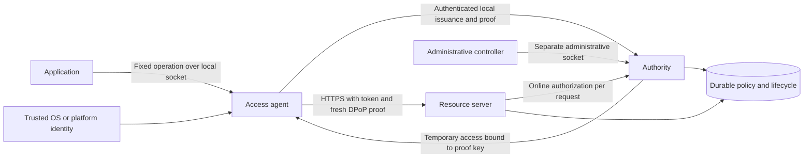
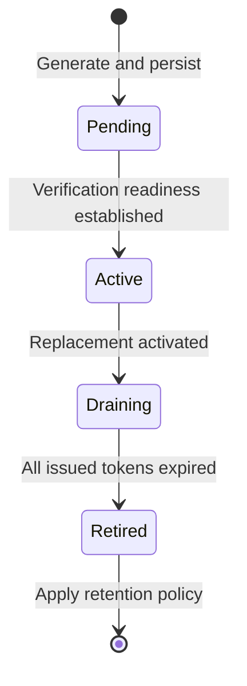

# Portable Access Profile: local profile v0.1

This local profile remains implemented in release 0.2. The additional network profile is specified in [PAP-Netlify-Origin-0.2](production-profile.md). Statements below about absent network adapters describe the original local profile, not the complete 0.2 release.

Status: experimental, proposed open specification
Version: 0.1
Date: 2026-10-22
Short name: PAP
Document license: Apache-2.0, as recorded in the repository's LICENSE

PAP defines how a workload obtains and uses narrowly scoped endpoint access without receiving a permanent API secret. Trusted infrastructure handles credential generation, renewal, replacement, and revocation. The application requests permitted operations and receives their results.

This document is a proposal and a reference implementation contract. It is not an IETF standard, a certification, or an endorsement by a hosting platform. It does not establish interoperability with Netlify, Railway, AWS, or any other provider. That requires provider adapters and independent implementations.

## 1. Requirements language and scope

The words MUST, MUST NOT, SHOULD, SHOULD NOT, and MAY identify requirements of this proposed profile. They do not imply approval by a standards organization.

This version defines a local reference profile called `PAP-local-0.1`. It specifies a protected Unix socket bootstrap, an access agent, a local authority, and an HTTPS resource server. Its wire formats use JSON and JWTs. A future `PAP-network` profile will require a separately specified platform identity adapter, authenticated issuer discovery, federation rules, and interoperable issuance semantics.

An implementation MUST identify its profile and version. An implementation MUST NOT present local Unix user authentication as cloud deployment attestation or as cross-process isolation between applications with the same operating-system user.

PAP-local does not include legacy API credential connectors. A connector can be added later, but its credential replacement API and failure behavior require a separate contract. Hiding a legacy key alone does not provide automatic rotation.

## 2. Design constraints

1. The application MUST NOT need a provider API key, signing key, refresh token, or other permanent application secret in its environment, source, build artifact, or configuration.
2. The absence of application secrets MUST NOT be described as the absence of cryptographic secrets in infrastructure. Authority signing keys, agent proof keys, and TLS keys still exist.
3. Identity MUST come from an explicitly trusted platform or operating-system boundary. A caller's claimed project, tenant, environment, or hostname is not proof of identity.
4. A permission grant MUST name its workload, tenant, deployment environment, resource audience, allowed operations, and expiry.
5. Each resource request MUST require a sender-constrained access token and a fresh proof from the corresponding private key.
6. Authorization MUST consult current persisted policy for each request. Token validity alone does not authorize a request.
7. Renewal and planned credential replacement MUST run without application redeployment or copying secret values.
8. Revocation MUST be persistent and MUST NOT silently re-enable access. A separate authorized administrative decision is required to restore access.
9. If identity, signature verification, current policy, or required persistence cannot be established, the implementation MUST deny the operation.

## 3. Components and trust boundaries

| Component | Responsibility | Sensitive material |
| --- | --- | --- |
| Application | Request a fixed operation from its local agent | No PAP credential |
| Access agent | Authenticate its local caller, obtain access, renew proof keys, validate API TLS, send signed requests | Temporary proof private key and access token |
| Identity bootstrap | Bind an agent connection to a known workload using trusted infrastructure | Platform trust and identity configuration |
| Authority | Evaluate grants, issue access, publish verification keys, maintain credential lifecycle | Issuer signing keys and current policy |
| Resource server | Validate tokens and proofs, consult current authority policy, enforce operation constraints | TLS key and trusted authority channel |
| Administrative controller | Create grants, revoke access, submit compromise events, inspect lifecycle state | Authority to change policy |
| Durable store | Persist lifecycle state, grants, revocations, replay protection, idempotency, quotas, and audit records | Infrastructure secrets and security state |

An online authority can be a customer-operated component. PAP does not require a global broker or a particular SaaS vendor. Multiple independent trust domains are permitted only when their identity mappings and trust roots are explicit.

### 3.1 Local profile boundary

The local bootstrap MUST authenticate Unix peer credentials supplied by the kernel. It MUST NOT trust a UID in the request body or a forwarded identity header. A configured mapping binds the authenticated UID to a workload and its grants. The connection MUST fail when the host cannot supply supported peer credentials.

Authority control, administrative control, and application operation sockets MUST be distinct. Private state directories MUST restrict access to the configured service identity. Socket permissions MUST restrict their intended callers.

For the single-user demonstration, every component can run as one UID. That arrangement verifies protocol and lifecycle behavior inside one OS trust domain. It does not stop another process under that UID from accessing sockets, reading private files, or impersonating the agent. A deployment that needs application compromise containment MUST use separate UIDs, container or VM boundaries, and restricted socket mounts.

### 3.2 Network profile requirements reserved for a later revision

A network adapter MUST obtain workload identity from a host-authenticated source such as a verified platform assertion or an attested workload credential. It MUST verify the issuer, intended audience, expiry, freshness, deployment identity, and environment before assigning a PAP workload.

Network bootstrap and issuance MUST use authenticated TLS. Trust roots and permitted issuers MUST come from trusted provisioning. Caller-supplied discovery URLs and self-selected trust roots MUST NOT become trust automatically.

These are adoption requirements, not implemented cloud adapters. The local profile does not issue OAuth Token Exchange requests. [RFC 8693](https://www.rfc-editor.org/rfc/rfc8693.html) is a candidate mechanism for a later network adapter. [RFC 8414](https://www.rfc-editor.org/rfc/rfc8414.html) defines OAuth authorization server metadata, which a future OAuth adapter can use with authenticated issuer provisioning. The custom local endpoints in this release do not constitute a complete OAuth authorization server.

## 4. Permission model

A grant MUST contain the following logical fields. An implementation MAY use different persisted field names if its public contract defines the mapping.

| Field | Meaning |
| --- | --- |
| Grant identifier | Stable, unambiguous identifier for authorization and audit |
| Workload identifier | Identity derived from the authenticated bootstrap |
| Tenant | Tenant that owns the records or operation |
| Environment | Deployment environment, such as `development` or `production` |
| Audience | Exact resource service allowed to accept the token |
| Operations | Explicit allowed operations, such as `records.read` and `notes.create` |
| Expiry | Absolute time after which the grant cannot authorize access |
| State | Active or revoked, with a persisted transition history |
| Constraints | Operation limits and quotas enforced by the resource server |

A missing field MUST NOT imply unrestricted access. An agent MUST request a known grant, and the authority MUST bind it to the authenticated workload. Resource request tenant, environment, and audience MUST agree with both the token and current grant. Checking only one of these layers is insufficient.

A grant expiry check MUST run on each resource authorization, even when the expiry sweeper has not executed. The sweeper records expiry transitions for operation and audit; scheduling delay MUST NOT extend permission.

The authority MUST reject further issuance for revoked or expired grants. A valid, unexpired token MUST fail on its next authorization check after the associated grant revocation commits.

## 5. Credential formats and proof checks

The local profile uses P-256 keys and ES256 signatures. Algorithm selection MUST be explicit. The verifier MUST reject unsigned tokens, symmetric algorithms, unexpected key types, private JWK parameters, and unknown issuers or signing keys. A `kid` identifies an issuer key, not a trusted URL.

Access tokens MUST include an issuer, audience, subject workload, issued-at time, expiry, unique token identifier, grant identity, tenant, environment, permitted operations, and a confirmation thumbprint for the agent proof key. Issuance MUST cap token expiry at the current grant expiry.

PAP-local uses an `at+jwt` token header with an opaque `kid`. Its claims are `iss`, `aud`, `sub`, `client_id`, `iat`, `exp`, `jti`, `cnf`, `tenant`, `environment`, `grant_id`, `epoch`, and `scope`. `cnf.jkt` binds the proof key. `scope` contains space-separated operation names. `epoch` records the workload's persisted revocation generation and MUST equal its current value. The local implementation resolves tenant and environment through the bound workload and audience through its fixed authority configuration. These values are logical grant constraints even when normalized into related database records.

After cryptographic validation, the reference implementation checks current issuer-key state again inside the authorization transaction. Its internal authorization result includes `_issuer_kid` to identify the verified signer during a later write-commit check. `_issuer_kid` is internal metadata. It is never a wire JWT claim and MUST NOT be accepted as a caller-supplied substitute for signature verification.

Resource requests use `Authorization: DPoP <access-token>` and a `DPoP` proof. This profile uses the proof construction and token binding defined in [RFC 9449](https://www.rfc-editor.org/rfc/rfc9449.html). Required checks include the proof signature, `typ`, `alg`, public JWK, method, target URI, timestamp, unique proof identifier, server nonce, token hash, and confirmation thumbprint.

PAP adds durable, atomic replay state. A proof accepted once MUST fail when replayed, including after process restart and when multiple requests arrive concurrently. Issuance nonces are single-use. A resource nonce MAY serve several requests until its expiry, but each accepted proof MUST have a distinct `jti`. Nonce state MUST expire and be bounded. A nonce MUST be bound to its intended security context. The implementation MUST NOT consume valid nonce state for an unauthenticated proof before verifying its cryptographic and binding checks.

DPoP does not cover request bodies or query strings. TLS protects transport integrity. The resource server still MUST validate request bodies and enforce operation policy. PAP-local has no query-driven authorization. An extension that adds security-sensitive query parameters MUST define and test their interpretation rather than assuming DPoP binds them.

### 5.1 Local issuance

The authority exposes `/v0/challenge` and `/v0/token` through its protected Unix socket. The agent obtains a nonce, creates a fresh proof key, and proves possession during issuance. The authority obtains workload identity from the connection's kernel credentials.

The logical token endpoint URI for local DPoP validation is exactly `http://authority/v0/token`. This is a local Unix transport convention. It is not permission to send tokens or identity assertions over network HTTP. Implementations MUST reject network use of that local exception.

Issuance MUST apply current grant state and issuance limits. The agent MUST create a new proof key for each successful access renewal. It MUST NOT reuse an old token with a new proof key. The agent MUST install the new key and corresponding token as one logical update.

The local authority routes are:

| Unix socket | Method and path | JSON contract |
| --- | --- | --- |
| `authority.sock` | `GET /v0/bootstrap` | Returns configured `origin`, `issuer`, `audience`, `subject`, `tenant`, `environment`, current `tls_certificate`, and `tls_generation` |
| `authority.sock` | `POST /v0/challenge` | Accepts `jwk`, a public P-256 JWK; returns `nonce` |
| `authority.sock` | `POST /v0/token` | Accepts `jwk` and `grant_id`; requires the `DPoP` header; returns the bound credential response |
| `admin.sock` | `GET /v0/status` | Returns redacted current policy and lifecycle metadata |
| `admin.sock` | `GET /v0/audit` | Returns the most recent 100 persisted audit events |
| `admin.sock` | `POST /v0/events` | Accepts `event_id`, `kind`, `subject`, and `reason`; returns the persisted event result |

The credential response contains `access_token`, `token_type` equal to `DPoP`, `expires_at` as a Unix timestamp, `expires_in` in seconds, `dpop_nonce`, `tenant`, and `environment`. Only the agent receives this response. Application-facing methods MUST NOT return it.

Administrative event `kind` is `revoke_workload` or `revoke_issuer_key`. `reason` is `operator` or `compromised`. `subject` is the relevant workload identifier or issuer `kid`. `event_id` is a canonical lowercase UUID string. The API MUST reject extra JSON fields and incorrect field types. These local administrative methods are a host reference contract, not a proposed public unauthenticated management API.

### 5.2 Protected endpoints

The reference resource operations are:

| Method and path | Operation | Request requirements |
| --- | --- | --- |
| `GET /v0/tenants/{tenant}/records` | `records.read` | Exact authorized tenant, current grant, valid token and DPoP proof |
| `POST /v0/tenants/{tenant}/notes` | `notes.create` | Same authorization, schema-valid JSON, UUID `Idempotency-Key` |

The agent MUST offer fixed typed operations. It MUST NOT accept arbitrary outbound URLs, arbitrary methods, caller-supplied authorization headers, or security-sensitive forwarded headers. The application selects an operation and supplies validated operation data. The agent derives the destination from trusted configuration.

The local application socket is `agent.sock`. It exposes `GET /v0/records`, `POST /v0/notes`, and `GET /v0/status`. The note operation uses the same body and `Idempotency-Key` requirements as the resource operation. The agent derives tenant from its issued access and cannot accept a caller-selected tenant or destination. Its status contains readiness, successful renewal and proof-key rotation counts, credential expiry, and last error category. Status MUST NOT include tokens or keys.

The resource server MUST reject invalid JSON, unexpected fields, oversized bodies, invalid identifiers, and unsupported content types. It MUST independently validate every field even if the agent already validated it.

The local note body has exactly one field, `message`, a string of 1 to 1000 characters. Successful writes return HTTP 201 with an opaque note `id`, `tenant`, and `created` equal to `true`. Idempotent duplicates return the same stored result. Record reads return `tenant` and a `records` array. The prototype uses synthetic records and must not be described as an adapter for an existing customer database.

Local HTTP requests have an 8192-byte body limit. Browser `Origin` headers and query parameters are rejected. The HTTPS service also exposes `GET /health` for readiness and `GET /.well-known/jwks.json` for public pending, active, and draining signing keys. Public key metadata contains no private key values and does not establish trust by itself. DPoP targets use the configured origin, never caller-supplied `Host` or forwarding headers.

For writes, the resource server MUST scope idempotency to the authenticated authorization context and operation. A repeated UUID with the same canonical request MUST return the stored result without a second mutation. The same UUID with changed content MUST fail with a conflict. Authorization MUST run before returning a stored result, so revocation cannot be bypassed through idempotency retrieval. The mutation and saved idempotent result MUST commit in one transaction.

Immediately before a note mutation or saved-result lookup, the reference implementation rechecks current issuer-key state, workload state, revocation epoch, grant expiry, tenant, environment, write permission, and token expiry inside the write transaction. A workload or issuer-key revocation or an expiry between initial request admission and that transaction therefore prevents the write. This does not undo a mutation that committed before revocation.

Quotas MUST use persisted, atomic accounting. Parallel requests MUST NOT bypass a limit by racing counters. A rejected or duplicate request MUST have defined quota behavior. Limits and retention periods MUST be documented by each implementation.

The reference quota counts admitted authorization attempts per workload in fixed 60-second buckets, including an authorized idempotent duplicate. Rejected authorization and over-limit requests do not commit their counter update. Issuance has a separate per-workload limit of 30 per minute and no more than 20 outstanding issuance challenges. Idempotency results, notes, administrative event deduplication, and audit records currently remain until the private demo state is removed. There is no automatic pruning for those tables in v0.1. This preserves retry history during a demonstration, but a long-running deployment requires an explicit retention and capacity policy.

## 6. Lifecycle contract

An implementation MUST manage the following lifecycles. It MUST make current state and failures observable without returning private keys or access tokens.

### 6.1 Agent access renewal

The agent MUST renew before token expiry, with enough time for the configured retry budget. It MUST create a fresh P-256 proof key for each renewal. Background renewal MUST run during idle application periods. Startup and request handling MUST refuse to use expired access.

Transient renewal failures MAY be retried with bounded backoff. The agent MUST keep the previous valid token and its key together until replacement succeeds or the token expires. It MUST stop protected access when no valid credential remains. It MUST NOT extend a token locally or fall back to a permanent secret.

The local demonstration MAY use a request retry to recover from an issuer-key or TLS transition. A write retry MUST preserve its idempotency key. Other automatic retries MUST be limited to operations with explicit replay safety.

### 6.2 Issuer signing-key rotation

The authority MUST persist a new key as pending before activation. It MUST establish that the resource verifier can obtain the public key before issuing tokens under it. It MUST switch active issuance atomically so that exactly one key is active.

The old key MUST stop new issuance after replacement. Its verification material MUST remain available until every token it signed has expired, including allowed clock skew. A retired private key SHOULD be destroyed as soon as it is no longer needed. Deletion from a database does not establish cryptographic erasure of backups or storage media.

Lifecycle reconciliation MUST survive restart at any transition. It MUST derive the next safe action from durable state. It MUST NOT generate an unbounded sequence of pending keys because a retry lost its response. The local runtime also removes an incomplete `runtime.json.next` under its acquired host lock before publishing a new runtime manifest. Interrupted manifest output MUST NOT permanently prevent restart.

The local reference uses one authority and one transactional store. A horizontally scaled authority needs leader coordination or transactional ownership before it can make the same single-active-key guarantee.

### 6.3 TLS credential rotation

The HTTPS resource server MUST require verified TLS. For the local profile, the agent receives the current trusted self-signed certificate through the protected authority bootstrap. It MUST use that certificate as an explicit trust anchor and MUST verify the configured endpoint identity. It MUST NOT disable TLS validation.

The service MUST generate a new leaf key and certificate automatically before expiry. A transition MUST make the new trusted certificate available through the protected bootstrap. The agent MUST refresh trusted certificate state through that channel when reconnecting after a rotation. The application MUST NOT handle certificate private keys.

A TLS refresh retry MUST reconnect to the configured endpoint only. An arbitrary untrusted server certificate MUST NOT become trusted based on the TLS failure. The trust root for this demonstration is the OS-protected authority channel. A production network adapter requires externally provisioned trust and a separately specified trust-anchor rollover process.

### 6.4 Revocation and compromise events

Revocation is triggered by an explicit administrator decision, a configured automated compromise response, or grant expiry. Automatic compromise response MUST use an authenticated event source and a defined rule. PAP-local demonstrates this with an authenticated administrative compromise event. It does not detect every possible credential theft or workload compromise.

The authority MUST persist the revocation and its audit record before reporting success. Every new resource authorization after the commit MUST observe the revoked state. Requests whose authorization already completed MAY finish. The implementation MUST document this race boundary.

The local profile uses online authorization with no positive authorization cache. If the authority or required policy store is unavailable, the resource server MUST deny access. Availability cannot override revocation by accepting a previously cached grant.

Revocation MUST survive authority, agent, and resource server restarts. Background renewal MUST NOT undo it. A restored grant MUST result from a new explicit administrative policy decision, with an audit trail.

Issuer-key emergency revocation requires a way to reject tokens signed by a compromised key before their expiry. The local administrative event types are `revoke_workload` and `revoke_issuer_key`. The first disables the workload and its grants and advances its revocation epoch. The second marks the selected issuer key revoked, removes its stored private value, and triggers replacement when needed. Tokens signed with a revoked issuer key MUST fail even when they have not expired. Administrative events MUST carry a UUID event identifier; repeating the same event MUST return the recorded result, and changing the payload under that identifier MUST fail with a conflict.

A deployment MUST NOT describe ordinary scheduled key retirement as complete issuer-compromise response. The automatic event path does not detect compromise itself or recover a hostile authority or trust root. Wider infrastructure compromise requires operator containment and trusted recovery.

## 7. State, time, and failure behavior

Security state MUST persist before success is acknowledged. Grant changes, replay consumption, quota changes, idempotency results, and audit records MUST use transactions appropriate to their invariants. Startup MUST refuse insecure state permissions or unsupported peer authentication.

An implementation MUST document its timing and retention behavior. A value MAY be a fixed profile constant, a value derived from another setting, or deployment-configurable. Documentation MUST distinguish these cases. Configurable values MUST be checked against their supported ranges before use. Implementations MUST preserve the required proof replay window, token verification drain period, pre-expiry renewal, and grant expiry behavior for every supported configuration. These requirements do not require an operator-facing setting for every value.

In this reference, `Config` supplies token lifetime, proof age, future-proof allowance, issuer and TLS replacement intervals, initial grant lifetime, quota, and controller tick. The CLI exposes `--grant-ttl` and the fixed `--accelerated` preset rather than individual switches for every `Config` field. Issuance nonce lifetime is a fixed 15-second constant. Resource nonce lifetime, issuer drain deadline, certificate validity, and the agent's renewal target are derived from profile settings. Idempotency, note, administrative event, and audit retention is indefinite until explicit private-state disposal. No configurable retention or automatic pruning for those tables is implemented.

The reference defaults are a 30-second token, 10-second accepted proof age, 2-second future-proof allowance, 90-second issuer replacement interval, 120-second TLS replacement interval, 3600-second initial grant, and 120 admitted resource requests per workload per minute. The agent starts renewal after approximately 60% of its current credential lifetime. Resource nonce lifetime is token lifetime plus configured skew plus one second. TLS certificate lifetime is at least 60 seconds or three configured TLS replacement intervals. The lifecycle controller runs every 0.25 seconds. The CLI's accelerated preset uses a 6-second token, 3-second issuer replacement interval, and 4-second TLS replacement interval. These values make local behavior observable; they are not a recommended production tuning profile.

The deployment MUST use trustworthy time. Backward or forward clock jumps can affect expiry and renewal. Operators MUST monitor clock health. Large clock errors MUST fail closed for time-bound authentication; they MUST NOT be hidden by large acceptance windows.

Error responses MUST distinguish authentication failure, policy denial, invalid input, conflict, throttling, and unavailable authority without returning credentials, private key material, or unnecessary identity detail. Logs MUST exclude authorization headers, proofs, request bodies containing sensitive data, and credential values.

Audit records MUST identify event type, time, and the relevant allowlisted workload, grant, issuer key, or operation metadata. The local reference records provisioning, credential issuance, issuer/TLS lifecycle, expiry, revocation, and note creation. HTTP responses carry a generated request identifier, but the local audit log does not provide a complete per-request allow/deny decision trail. Production deployments SHOULD correlate every authorization decision with a request identifier in a separate audit system.

Logs in a local SQLite database are useful for investigation but are not tamper-evident against the database owner. Production audit export SHOULD use a separate retention and access boundary.

## 8. Conformance and evidence

Conformance is a testable claim about a specified implementation and profile. Passing a test in this repository is evidence for that implementation only. It does not certify a provider, an independent implementation, or the security of a deployment.

The accompanying automated suite and demonstration should be checked against this matrix. Requirements marked "network extension" are deliberately outside local conformance.

| Requirement | Required evidence for `PAP-local-0.1` | Failure case |
| --- | --- | --- |
| No application credential | Application operation works without a token, key, or secret environment variable | Application requires or receives one |
| Trusted local identity | Peer UID accepted only through supported kernel credentials and configured mapping | Body or header identity overrides peer |
| Sender-constrained access | Stolen token fails with a different proof key | Valid bearer token alone succeeds |
| Proof freshness and replay | Stale proofs and duplicate proofs fail, including concurrent use | Both copies of one proof succeed |
| Tenant and environment | Cross-tenant and changed-environment requests fail | A valid signature bypasses grant boundaries |
| Narrow operation | A read-only grant cannot write | Agent or API accepts arbitrary operations |
| Automatic renewal | Idle-running agent replaces both token and proof key before expiry | Application must redeploy or copy a secret |
| Issuer rotation | Pending, active, draining, and retired transitions persist; old valid tokens work during drain | Restart strands the verifier or reactivates an old key |
| TLS rotation | New key/certificate appears, trusted requests recover without disabling verification | Expired or arbitrary untrusted TLS is accepted |
| Immediate local policy check | Previously issued token fails after grant revocation commits | Token remains usable until expiry |
| Persistent revocation | Restart does not restore revoked access | Agent silently renews a revoked grant |
| Automatic expiry | Expired grant fails before and after sweeper execution | Sweeper delay extends permission |
| Compromise event | Authenticated event durably revokes access | Unauthenticated event changes policy or renewal restores it |
| Issuer-key emergency revocation | Old and forged tokens under the revoked key fail; new issuance uses a replacement | Scheduled drain leaves the compromised key usable |
| Write retry safety | Same UUID returns same result; changed body conflicts; concurrent duplicates create one note | Timeout retry creates a duplicate write |
| Fail closed | Missing policy or verification state denies the operation | Cached permission permits access indefinitely |
| Provider interoperability | Network extension, not claimed by this release | Local demo described as deployed provider support |

The implementation README and generated test report record which checks actually ran. This specification describes required behavior. It is not a substitute for test results.

### 8.1 Reference implementation coverage

| Local contract | Current implementation | Evidence entry point |
| --- | --- | --- |
| Peer identity and protected local HTTP | `pap/local.py`, `pap/runtime.py` | Local runtime and integration tests |
| Strict DPoP and token verification | `pap/crypto.py`, `pap/authority.py` | `tests/test_security.py`, including changed key, target, token hash, claims, algorithm, and JWK cases |
| Concurrent proof replay | SQLite transaction and unique proof-key/JTI pair | `test_concurrent_replay_admits_exactly_one_request` |
| Local interface denial | Kernel-identity return checks, fixed operations, and trusted origin validation | `test_admin_socket_rejects_different_peer_uid`, `test_agent_rejects_caller_supplied_targets_and_credentials`, `test_agent_rejects_remote_or_unencrypted_bootstrap_origin` |
| Current policy and persistent revocation | Workload state, epoch, grant expiry, and operation checks | `test_restart_preserves_revocation_and_event_deduplication`, `test_reprovisioning_cannot_restore_revoked_workload` |
| Issuer replacement and crash recovery | Durable signing-key states | `test_rotation_preserves_valid_old_tokens_until_retirement`, `test_restart_recovers_prepared_signing_key_before_issuing_tokens` |
| Issuer compromise revocation | Authenticated event and rejection of revoked key | `test_compromised_signing_key_is_rejected_immediately_and_replaced` |
| Issuer revocation races | Current signer checked again under admission and write locks | `tests/test_regressions.py`, `test_issuer_revocation_between_crypto_check_and_admission_is_rechecked`, `test_signer_revoked_after_admission_cannot_commit_mutation` |
| Commit-time policy enforcement | Note transaction rechecks | `test_revocation_between_authorization_and_write_prevents_commit`, `test_expired_grant_between_authorization_and_write_prevents_commit` |
| Write result deduplication | Scoped UUID and message digest | `test_idempotent_write_reuses_response_and_rejects_different_payload` |
| Concurrent writes and quota | Transactional unique operation result and quota admission | `test_parallel_idempotent_writes_commit_only_one_note`, `test_parallel_requests_cannot_exceed_authorization_quota` |
| Idle agent renewal and local TLS replacement | `pap/agent.py`, `pap/runtime.py` | `tests/test_integration.py`, `test_full_automatic_lifecycle_acceptance`, and CLI demonstration |
| Incomplete manifest recovery | Startup removes abandoned private temporary manifest under host lock | `tests/test_regressions.py`, `test_abandoned_runtime_metadata_write_does_not_block_restart` |
| Cloud identity, legacy adapters, federation, distributed authority | No implementation in v0.1 | Not claimed; separate adapter and conformance work required |

This coverage map points to executable checks. Test results may change with the code revision. Negative peer-UID tests substitute the kernel-identity return boundary; they do not execute an attack from a second real OS account. Passing the listed cases does not establish every deployment requirement in this document, such as process isolation, trustworthy wall-clock operation, production retention, and independent network interoperability.

## 9. Relationship to existing work

PAP combines existing mechanisms with a product-facing lifecycle and operation contract. It introduces no new cryptographic algorithm.

- [RFC 9449](https://www.rfc-editor.org/rfc/rfc9449.html) supplies DPoP proof and token-binding mechanisms. PAP adds local bootstrap rules, grant policy, and lifecycle requirements. Its custom local issuance is not a general OAuth grant.
- [RFC 8693](https://www.rfc-editor.org/rfc/rfc8693.html) provides OAuth Token Exchange. PAP-local does not implement it.
- [RFC 8414](https://www.rfc-editor.org/rfc/rfc8414.html) provides authorization server discovery metadata. PAP-local does not claim that discovery makes an issuer trusted.
- [SPIFFE](https://spiffe.io/docs/latest/spiffe-about/spiffe-concepts/) provides workload identity concepts and documents. A future adapter could verify a suitable SPIFFE identity rather than assigning identity from local UID.
- [WIMSE architecture](https://datatracker.ietf.org/doc/draft-ietf-wimse-arch/) addresses workload identity across systems. As checked on 2026-10-22, `draft-ietf-wimse-arch-08` is an active Internet-Draft, not a published RFC. PAP does not claim compatibility merely because it uses similar concepts.

An open specification only becomes useful across platforms when independent implementations agree on identity semantics, authorization behavior, and failure handling. The next revision should prioritize those tests over a broader marketing claim.
