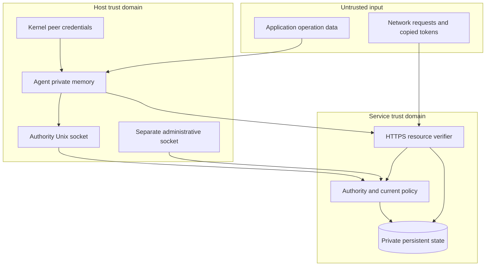

# PAP v0.1 threat model

This document models the retained local demonstration. Release 0.2 adds a separate Linux/OpenBao boundary and a Netlify origin-control profile; see the [0.2 trust and deployment contract](production-profile.md) for those assets, threats and readiness gates. Same-UID exposure and local private-key storage described below apply to the local commands, not the externally backed production command.

Status: experimental reference implementation analysis
Date: 2026-10-22

The prototype removes permanent endpoint credentials from the application interface. It does not remove trust, eliminate secret material from infrastructure, or make a compromised authorized workload harmless.

## Protected assets and intended guarantees

The application must not receive authority signing keys, TLS private keys, agent proof keys, or access tokens. The authority must issue access only to a trusted workload with an active grant. The API must enforce the grant's tenant, environment, audience, operation, and expiry on every request. A copied access token must be insufficient to call the API without the matching proof key.

Credential renewal and planned key rotation must continue without application changes. Persisted grant revocation must stop subsequent authorizations, including authorizations that use previously issued tokens. A lost write response must not make an automatic retry create duplicate notes.

## Trust boundaries

In the local demonstration, the host and service domains can share one UID. The diagram describes logical roles. It does not imply the operating system enforces separation between them.

The trusted computing base includes the kernel, the configured administrative user, the Python runtime and dependencies, the authority, resource verifier, agent, and their private state. A compromise of one of those components can invalidate relevant guarantees.

## Attacker capabilities

The tests should assume an attacker can call the HTTPS API, choose all unauthenticated request fields, construct JWTs, possess a copied valid token, send concurrent requests, replay captured proofs, and exploit request retries. The attacker can also submit malicious operation inputs through an authorized application.

The protocol does not defend against a hostile kernel, root access, a compromised authority administrator, or a process with access to the authority database and private keys. It does not claim to stop an attacker with the same UID as every component in the demonstration.

| Threat | Control in the local profile | Residual risk or limit |
| --- | --- | --- |
| Application accidentally logs or exposes a long-lived API key | Application receives fixed operation results; agent retains credentials | Operation responses can contain customer data and still need handling controls |
| Attacker copies an access token | DPoP proof and token confirmation bind access to the agent key | Theft of both token and private key permits access within current policy |
| Proof replay | Short proof age, server nonce, persisted atomic replay consumption | Time health and state availability are required |
| Cross-tenant confused deputy | Server compares path tenant, token tenant, and current grant; agent fixes destination | Incorrect issuer identity mapping can still assign the wrong grant |
| Environment or audience substitution | Exact server-side checks against current policy and token | A host with a weak identity boundary can falsely label a deployment |
| Forged identity header | Kernel Unix peer credentials determine workload | Same-UID processes remain one trust domain |
| Signing algorithm confusion | Explicit ES256/P-256 verification, trusted issuer/key lookup, no dynamic key URL | Dependency and parser defects remain possible |
| Agent becomes a general-purpose authenticated proxy | Fixed typed operations and configured HTTPS destination | Authorized operations can still be abused within their limits |
| Request body changes | TLS verification, strict body schema, operation authorization | DPoP alone does not sign the body |
| Retried write creates duplicates | Durable UUID idempotency, body fingerprint, transactional note/result commit | Retention defines how long the duplicate guarantee lasts |
| Concurrent requests exceed quota | Atomic persisted accounting | One-node SQLite does not provide a multi-region quota service |
| Revoked token survives until expiry | Online policy and issuer-key checks inside admission; note commit repeats revocation and expiry checks | Already committed mutations cannot be undone; previously authorized reads can complete |
| Revocation lost after restart | Durable policy and audit transaction | Malicious rollback to an older database snapshot can restore old state |
| Automated renewal re-enables a compromised grant | Renewal always checks persisted grant status; restoration requires admin action | Automated detection needs trustworthy event sources |
| New issuer key unavailable to verifier | Pending/active/draining/retired lifecycle and online key access | Production distributed caches require explicit acknowledgement and drain rules |
| TLS replacement causes permanent outage | Protected trust refresh and safe retry with verified new certificate | Authority-channel loss denies access; no insecure fallback |
| Administrative action through application interface | Separate admin and application sockets | Real containment requires separate identities and socket ownership |
| Disk or backup reveals infrastructure secrets | Restrictive local file permissions and isolated execution recommendation | Local state is not hardware-backed or encrypted by this prototype itself |
| Audit evidence altered | Persisted structured events | SQLite owner can alter records; no tamper-evident remote audit sink |
| Authority unavailable | Fail-closed resource decision | Access availability depends on authority and store availability |

## Compromised application behavior

The agent prevents routine application code from obtaining PAP credentials through its supported API. It still performs allowed operations for the application. A compromised application with `notes.create` can submit unwanted notes until policy, quota, or revocation blocks it.

The containment boundary is the permission grant. Production integrations should grant only required operations and limit tenant, environment, amount, destination, or resource category where the API supports those restrictions. Prompt injection resistance cannot come from the token alone. An AI caller needs deterministic operation validation and policy checks outside its model context.

A production application and its agent should run in different OS security contexts. Only the operation socket should be mounted into the application. The authority socket, administrative socket, private database, and agent process inspection capabilities must remain unavailable. A sidecar sharing the application's UID and filesystem does not meet that boundary.

## Rotation is not complete compromise recovery

Scheduled signing-key replacement reduces credential age. It does not erase credentials already copied from memory or backups, identify every attacker, or repair compromised infrastructure. Workload revocation stops future authorization for its grants. An authenticated `revoke_issuer_key` event immediately rejects that key and triggers replacement. Compromise of the authority process, its durable state, or the TLS trust root still needs a wider recovery plan.

Recovery must disable compromised trust, provision a trusted replacement through an independent channel, invalidate affected grants or tokens, and investigate the cause before restoring access. The v0.1 prototype does not automate root-of-trust recovery or provider account recovery.

Automatic revocation in this release means an authenticated compromise event causes the defined persisted policy action. It does not mean the software autonomously detects all attacks. An unauthenticated report must never have authority to revoke arbitrary customers' grants.

## Availability and state consistency

The API performs an online policy check per protected request. This gives the local implementation a clear revocation boundary. It adds an authority dependency to every call. Without a measured deployment, no latency or availability improvement is claimed.

The SQLite reference demonstrates transactional security invariants on one host. A production service needs coordinated writers, backup policies, disk encryption, recovery exercises, rate controls before expensive verification, and availability architecture. Restoring security state from backup must not resurrect a revoked grant or consumed nonce. The production design must define a monotonic revocation epoch or equivalent trusted recovery procedure.

Long-running deployments need a bounded retention and capacity policy. Replay entries must remain for the full accepted proof interval and clock skew. Verification keys must remain for the longest token they signed. Idempotency records must remain for the documented retry window. Pruning earlier breaks their respective guarantees; never pruning them creates a storage denial-of-service risk. The v0.1 local reference prunes expired nonces, proofs, and old rate buckets, but keeps note, idempotency, administrative event, and audit records until explicit private-state disposal. It does not implement configurable retention for those tables.

## Acceptance boundaries

Successful automated tests establish behavior under their tested cases. They do not establish resistance to every exploit or certify production readiness. Before public network deployment, obtain an independent review of identity bootstrap, DPoP handling, lifecycle state transitions, concurrent database operations, denial-of-service controls, and administrative recovery.

Provider adapters require their own threat models. A platform assertion that identifies a customer account but cannot distinguish one deployment from another is insufficient for workload-level authorization. Platform claims must be documented and tested against compromised neighboring deployments.

## Standards references

The DPoP threat considerations and request-integrity limitations are described in [RFC 9449, section 11](https://www.rfc-editor.org/rfc/rfc9449.html#section-11). This profile's atomic replay persistence and online revocation requirements are additional implementation requirements.

SPIFFE's [workload concepts](https://spiffe.io/docs/latest/spiffe-about/spiffe-concepts/) explicitly depend on workload isolation. Using an identity format does not create that isolation. The prototype's UID bootstrap is its own local mechanism and does not implement SPIFFE attestation.
