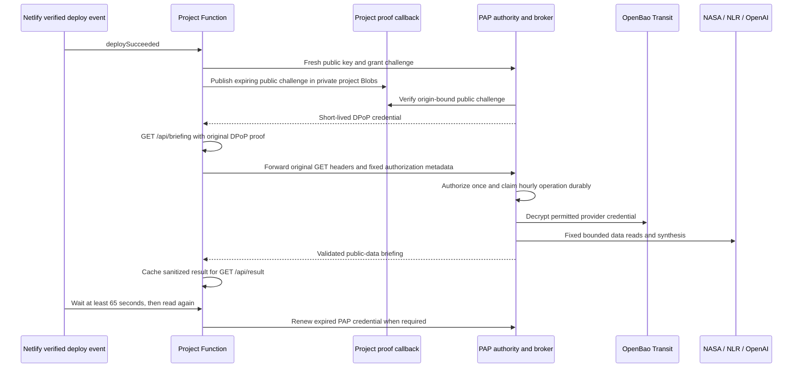

# Three independent Netlify examples

The examples demonstrate a specific deployment pattern: a trusted production Netlify Function calls an authority broker with a short-lived PAP proof. The authority calls approved providers with centrally encrypted keys and returns a bounded result. Application code never receives the upstream API keys.

| Project | Fixed data source | Fixed OpenAI operation | Protected resource |
| --- | --- | --- | --- |
| `space-briefing` | NASA NeoWs, current UTC day | Summarize near-Earth-object observations | `GET /api/briefing` |
| `charging-briefing` | NLR alternative-fuel stations, fixed Charleston WV EV query | Summarize charging infrastructure | `GET /api/briefing` |
| `science-digest` | Both fixed sources | Produce one combined public-data digest | `GET /api/briefing` |

Each project has its own Netlify site, grant and tenant. All three use the configured authority audience. The operator may reuse one OpenAI provider credential across these grants. Reusing a provider credential couples its upstream quota and billing, while PAP authorization and hourly job admission remain separate by grant and operation. Use separate upstream projects or keys when provider billing and revocation must be independent.

The examples use `gpt-4.1-mini` through the OpenAI Responses API, `store: false`, no tools, and a bounded output budget. Provider observations are data, never instructions. Callers cannot choose a URL, location, date range, model, prompt or tool. The authority configuration fixes each operation and its allowed grant.



## Deploy a project independently

Use the complete public checkout with a Netlify base directory of `examples/<project>`, or download a standalone example archive from GitHub Releases. The standalone archive includes its SDK under `vendor/`; it needs no sibling checkout. The example's `netlify.toml` keeps Function source outside `public/`, uses the default runtime region and allocation, and refuses deploy previews and branch deploys.

1. Deploy the authority and key service using the operator guide. Configure a dedicated Transit credential key and its least-privilege authority policy. Enable only the required connector operation and bind it to a new grant.
2. Create a dedicated Netlify production site. All trusted source and deployment paths able to serve its production origin share its identity boundary. Put untrusted preview code in a separate site.
3. Register its canonical `https://SITE.netlify.app` origin, site UUID, subject, tenant, audience, explicit grant expiry, `/api/briefing` path and matching `<project>.read` action at the authority. Keep that grant ID in the connector operation configuration.
4. Install the project dependencies. In a source checkout first build `adapters/netlify`. In a standalone release archive run `npm ci --ignore-scripts` directly.
5. Configure public bindings with the included command. These values are public identifiers, so command arguments are suitable here.

```sh
npm run configure -- \
  --issuer-url https://authority.example.com \
  --site-id 11111111-1111-4111-8111-111111111111 \
  --grant-id project-production \
  --resource-origin https://your-project.netlify.app \
  --tenant project-tenant \
  --audience urn:pap:project \
  --acknowledge-trusted-site
npm run check
```

6. Provision provider credentials through the operator credential-import workflow. Do not add provider keys to the example configuration, build settings or Function environment. See [connector operation and custody details](connectors.md).
7. Publish a production deploy. Netlify dispatches its verified `deploySucceeded` platform event to the event-only Function. The event performs two protected reads at least 65 seconds apart and stores the latest validated result. There is no HTTP handler for this event function.
8. Check `/status.json`, then `/api/result`. The result route only reads an existing validated summary from that project's private Blobs store; it cannot start provider generation. It returns `202` until a completed deploy event has published a result. The protected `/api/briefing` route returns `401` to an unsigned request.
9. Review authority issuance and authorization audit records. With the reference 60-second access TTL, the second read must use renewed credentials. Two successful application log lines alone do not prove renewal. If you change the access TTL, increase the event wait beyond that TTL before claiming the same acceptance check.

## Free API credentials and cost bounds

NASA and NLR document a public `DEMO_KEY` for initial testing. These are shared demonstration credentials with restrictive provider quotas; they are not private per-user secrets. Register dedicated keys with each provider for sustained use and import them through the same operator custody path. NASA documents the APIs and quotas at [api.nasa.gov](https://api.nasa.gov/). NLR documents registration and demo access in its [API key guide](https://developer.nlr.gov/docs/api-key/).

OpenAI API usage is billed to the selected provider project. Each operation can start at most one synthesis per grant and UTC hour. Before a paid request, the authority writes a durable claim. Concurrent calls receive the completed cache or a redacted unavailable result. An uncertain paid outcome remains unavailable for that hour and is not retried automatically. Repeated deploy events therefore cannot create a second synthesis for the same grant, operation and hour. Moving into a new hour permits a new operation; provider budgets remain an additional necessary limit.

The public result contains public-data summaries and source counts, with no provider request URL query, authorization header or credential. Cache entries include generation time. Operators should remove the public result Function if a future use case handles confidential results.

## Failure and revocation behavior

Unconfigured examples return unavailable and skip their deploy event. Preview, wrong-site, wrong-origin, query-bearing, wrong-method and missing-proof requests fail before contacting the broker. The authority validates the original proof once and checks live grant state for each operation, including cache reads. Reusing a proof is denied. Revoking a grant blocks protected reads immediately at the authority, while already published public-data summaries remain public until removed or replaced.

A provider failure never exposes provider response text, the credential, or a request URL containing it. A deploy event records only operation, stage, outcome and a bounded error classification. It discards the cached client credential when finished. HTTP retries create fresh PAP proofs; the authority's durable hourly claim prevents duplicate paid synthesis.

PAP renews its own short-lived credentials and proof keys automatically. Replacing a provider's static API key requires that provider's supported issuance/revocation mechanism. Central custody removes application redeploys from key replacement, but cannot create an upstream rotation API where none exists.
